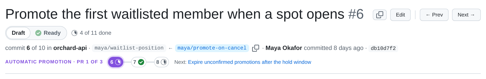

In Local Review, **one commit is one PR**. Each commit in a project's range is shown as a candidate pull request, with
a Conversation tab, a Files changed tab and a Stack tab, just like a GitHub PR. That is the shape it will have when it
goes up as a GitHub stacked PR: one PR per commit, each on the branch of the one below.

## What a PR is made of

| | Comes from | Override |
| --- | --- | --- |
| Title | the commit subject | `title:` in its [prs file](/reference/pr-files/), or **Edit** in the UI |
| Description | the commit body | `body:` in its prs file, or the description editor |
| Diff | the commit against its first parent, with rename detection; with [follow-up commits](#follow-up-commits), all of them | — |
| Number | its position in the repo, 1..n across all stacks, oldest first ("PR 3", `#3`) | — |
| Readiness | draft until you mark it ready | see [Readiness](/concepts/readiness/) |
| Branch | none until an agent tags one | see [Branches](/concepts/branches/) |

Overrides never touch the commit: they live in Local Review's files, so the reviewed repo stays exactly as it was.

Around it, a PR page shows where it belongs: **breadcrumbs** above the header (`Project › repo · STACK n · TITLE ›
PR #m`, the project and stack linking to their pages), and on the Conversation tab, above the description, the
collapsible [Project context and Stack context](/using/editing-pr-text/#project-and-stack-context) boxes that start
its full PR body.

## Why one commit per PR

- **It's how stacks are built.** Every stacking tool, GitHub's own included, works from a series of local commits;
  they differ only in how they map commits to PRs. Reviewing commits means reviewing exactly what will go up. See
  [Works with your stacking tool](/concepts/stacking-tools/).
- **Small PRs get real review.** An agent can write a dozen tidy commits in an afternoon. Reviewed as one branch they
  blur together; reviewed one at a time, each gets its own diff and conversation.
- **Fixes land where they belong.** A comment on PR 3 is fixed in PR 3, with `git commit --fixup` and an autosquash
  rebase, and the thread follows the rewritten commit ([Following rebases](/concepts/following-rebases/)).

## Follow-up commits

Fixing a commit with `--fixup` rewrites it, so a published PR has to be force-pushed. To fix a published PR the
GitHub way instead, with new commits on top of its branch that you push normally, set `pr_model: follow-ups` on the
repo in [project.yaml](/reference/project-yaml/#repos). Then a PR is its commit **plus the commits up to its
branch's head**:

- When a PR's recorded [branch](/concepts/branches/) has moved to a later commit in the range, one descending from
  the PR's commit, the commits in between are folded into that PR. They aren't PRs of their own, and the PRs above
  keep their numbers.
- The PR's diff runs from its first commit's parent to the branch head, so it includes the fixes. The header lists
  its commits, and its branch shows as `ok`.
- Its [prs file](/reference/pr-files/) and review file stay keyed by its first commit's sha.
- A commit that's a PR of its own (it has a recorded `branch:` or a `github:` record) is never folded into the PR
  below it.

Restack the PRs above with `git rebase --update-refs` (agent guide:
[follow-up commits](/agents/agent-guide/#alternative-follow-up-commits-on-a-published-pr-pr_model-follow-ups)).
Merging the lower branch into the one above instead isn't supported yet: the merge commit would show as a PR. Without
`pr_model`, every commit is a PR, as before.

## Shaping the commits

Each commit should be reviewable on its own, with a clear and unique subject. Split, squash and reorder with
`git rebase -i` until it is; then group the commits into [stacks](/concepts/pr-stacks/). The agent guide's
[Building the local representation](/agents/agent-guide/#building-the-local-representation-before-anything-goes-to-github)
covers this for agents.

## Numbers

PR numbers are positions across the whole repo, not per stack, and they include [landed PRs](/concepts/landed-prs/)
first, so they don't change when you regroup stacks or when PRs merge. They aren't GitHub PR numbers: once a PR is
published, its GitHub number shows beside it as a `#1234 ↗` badge.
