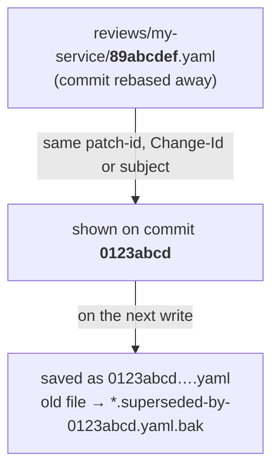
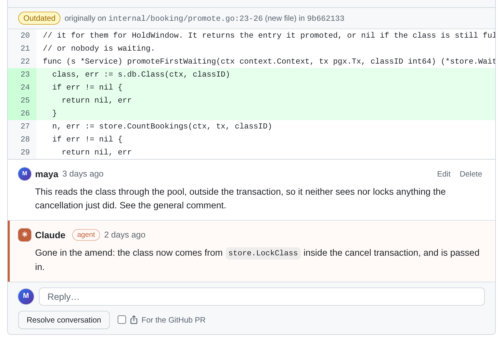

Stacks get rewritten all the time: a fixup squashed into a reviewed commit, a reword, a rebase onto a newer `main`.
Every rewrite gives the commits new shas, but your review is filed under the old ones. Local Review re-attaches each
file to its rewritten commit, then re-places each inline thread on the line it was about. Nothing is ever dropped:
a thread whose code is gone is marked **outdated**, not deleted.



The same rules apply to `reviews/` (comments) and `prs/` (title/description overrides, readiness, branch, GitHub PR).

## Which file belongs to a commit

With [`pr_model: follow-ups`](/concepts/commits-as-prs/#follow-up-commits), a PR's files belong to its first commit,
so adding follow-up commits on top renames nothing. Inline threads are placed on the PR's whole diff, so a fixed line
shows the fix, or the thread goes outdated (see [line anchoring](#line-anchoring-how-inline-threads-follow-the-code)).

When a commit has no file under its own sha, the server looks at the **orphaned** files in the same repo directory:
`<sha>.yaml` files whose sha is no longer in the repo's range.

These are never taken:

- a file whose commit is still in the range ([landed PRs](/concepts/landed-prs/) count as in it);
- a prs file with a `landed:` block (and landed PRs never take a file themselves);
- a file whose commit is still an ancestor of the range end: it only left the range because `base`/`from` moved (e.g.
  it landed upstream), it wasn't rewritten;
- a review file whose `repo_path` is a different repo and whose sha this repo doesn't have.

A file without `patch_id`, `subject` or `change_id` (a hand-written one) gets them from git for its sha.

The assignment is computed for the whole range, deterministically, in this order:

1. **Exact sha**: `<repo>/<sha>.yaml` exists. Nothing else is tried.
2. **Same patch-id** (`patch_id`): a pure rebase (e.g. onto a newer main) or a reword.
3. **Same Change-Id trailer** (`change_id`), if the commit has one. This goes before the subject because it's an
   explicit identity.
4. **Same subject**, after stripping leading `fixup!`/`squash!`/`amend!` and collapsing whitespace. Only used when the
   subject is unique among the range's commits (two `WIP` commits never match by subject). This is what catches
   fixups and amends that change the patch.

Each level is tried for every commit (oldest first) before the next level. Each orphan goes to at most one commit. If
several orphans qualify, the most recently modified file wins, then the lowest sha.

Until the next write, the comments are shown from the old file, as if they were the new commit's. On the next write
the server saves them under the new sha, adds the old sha to `previous_commits`, sets `matched_by`, and renames the
old file to `*.superseded-by-<sha8>.yaml.bak`, so it isn't matched again. Nothing is deleted.

The PR's Conversation tab says so, in a note under the "changes N files" line: **Review carried over from
&lt;sha&gt; after a rebase (matched by patch-id, Change-Id or subject)**. Until the next write it adds "It moves to
this commit's file on the next write"; after it, the note stays, naming the last of `previous_commits`. The
[HTTP API](/reference/http-api/) reports the same as `carried_over` (`from`, `by`, and `saved`: whether it's in the new
sha's file yet), with `matched_from` and `matched_by` for one still in the old file.


:::tip[Keep subjects stable]
A fixup or amend changes the patch, so the subject is what carries the review across. Don't reword a reviewed
commit's subject, and give every commit a unique one. [Stack selectors](/concepts/pr-stacks/) depend on subjects too.
:::

## Line anchoring: how inline threads follow the code

- **Creating an anchor.** When an inline thread is created (by the UI, or found without an `anchor` on the server's
  next write), the server stores `anchor`: the commit, the location, the exact `text` of the commented lines and up to
  3 lines of `before`/`after` context, on that side of the file. An agent-written thread without an anchor is anchored
  on the file's `commit`. If that's an old, rebased-away commit that's no longer in the repo, it's anchored on the
  current commit instead.
- **Two locations.** `path`/`side`/`line`/`start_line` always mean the location on the file's `commit`. `anchor` keeps
  the original location (like GitHub's `original_line`/`original_commit_id`) and is never rewritten. The one
  exception: if it's anchored on the current commit and you hand-edit `line`, the anchor is recomputed there.
- **Finding the file.** To place a thread on a commit other than `anchor.commit`, the server finds the file in that
  commit's diff by `path`, then as the old side of a rename, then by `anchor.path`/`anchor.old_path`.
- **Finding the lines.** It looks for `anchor.text` on the same side: exact matches first, then matches that differ
  only in whitespace. The best match is the one where the most `before`/`after` lines still fit, then the one nearest
  the last known line. A blank commented line needs at least one context line to fit.
- **Other files.** If the file isn't in the diff under any of those names (e.g. a newly added file renamed by a
  fixup), other files are searched too, but only an exact match with at least 3 fitting context lines (or all of
  them, if fewer) is accepted.
- **Mixed-side ranges.** A range with `start_side` is anchored on its last line; its first line's text
  (`start_text`) is then looked up on `start_side` near the same shift. If that line is gone, the thread becomes a
  single-line thread on its last line.
- **Found:** the thread is shown at the new line. The new location is written to `line`/`start_line`/`path` on the
  next write, and `anchor` is left as it was.
- **Not found** (the line was deleted or rewritten, or the file left the commit): the thread is **outdated**. The API
  returns `outdated: true` and the server writes `outdated: true`, keeping `line` as the last known location. The UI
  shows an "Outdated" label with the original code from `anchor`, in the Conversation tab and at the top of the
  file's card (in the Conversation tab only, if the file is gone from the commit), and in the
  [Comments tab](/using/ui-tour/#the-comments-tab). In Files changed and the Comments tab it starts folded to one row. If the code comes back in a later
  rebase, the thread is placed again. **Threads are never dropped.**



## Checking after a rebase

An agent can check that every thread re-attached:

```sh
curl -s http://localhost:5622/api/projects/my-feature/repos/my-service/commits/<new sha>/review \
  | jq '{carried_over, threads: [.threads[] | {id, outdated, line}]}'
```

`outdated: true` is expected where the agent deleted the commented lines; it should say so in its reply.
