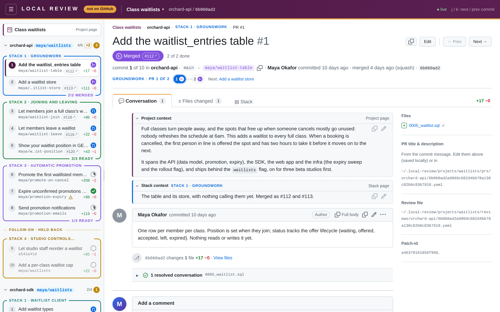
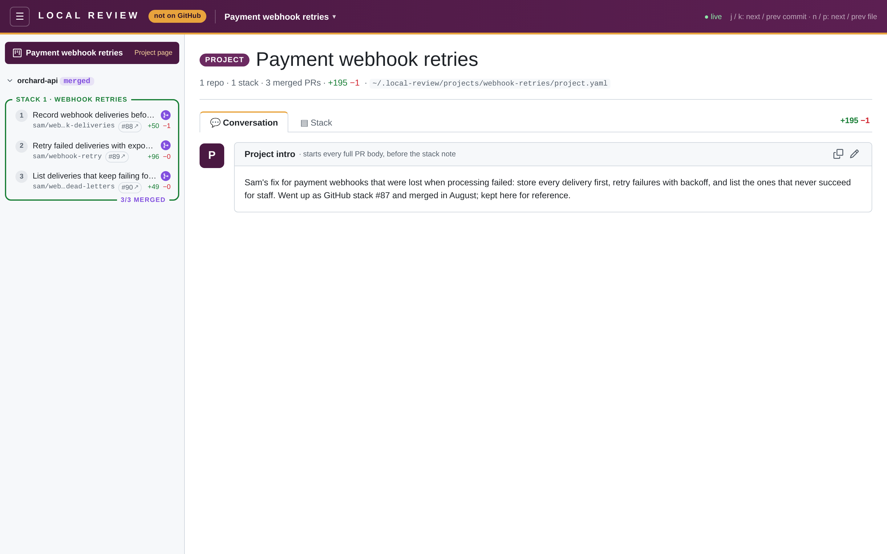

Once a stack goes up as GitHub stacked PRs and they merge, their commits leave the live range (the merge-base moves),
so on their own they'd vanish: stacks would empty out and PRs would renumber. Instead, the agent **freezes** each
merged PR before it fetches or rebases: it writes a `landed:` record into the PR's [prs file](/reference/pr-files/)
and appends the file's key to the repo's `landed:` list in `project.yaml`. The PR then stays in its stack, keeps its
number, shows a purple **Merged** badge, and still shows the diff GitHub merged.

Local Review only reads these records; it never calls GitHub. Freezing is the agent's job (see
[Freezing merged PRs](/agents/agent-guide/#freezing-merged-prs-before-any-fetch-or-rebase) in the agent guide).

```yaml title="project.yaml"
repos:
  - path: ~/code/my-service
    branch: me/my-feature
    base: origin/main
    landed: ["0a1b2c3d", "4e5f6a7b"]   # the merged PRs, bottom to top
```

```yaml title="prs/my-service/0a1b2c3d….yaml"
landed:
  head: <full sha>        # the PR's head at merge (headRefOid)
  base: <full sha>        # the PR's base at merge (baseRefOid)
  commit: <full sha>      # the merge or squash commit
  method: squash          # merge, squash or rebase
  at: 2026-10-09T12:00:00Z
```



## How landed PRs behave

- **Order and numbering.** A repo's PRs are its landed PRs, in `landed:` order (bottom to top), then its live
  commits. PR numbers ("PR 3", `#3`) are positions across both, so they don't change when PRs merge.
- **Keys.** Keys are prs file names (`<full sha>.yaml`): a full sha or a unique prefix (quote prefixes in YAML). A key
  that matches no file (or several), a file without a usable `landed:` block, or a duplicate is a warning on the repo,
  and is skipped. A landed PR whose commit is still in the live range (it was frozen before the rebase) is shown once,
  as landed.
- **Diffs.** A landed PR shows GitHub's view of it: `merge-base(landed.base, landed.head)...landed.head`. GitHub
  retargets each stacked PR to the base and rebases it there as the one below merges, so this is the PR's own change and
  nothing else, for a multi-commit PR too. If the head or base object isn't in the local repo (a deleted branch, never
  fetched), it falls back to the merge commit's first-parent diff (`commit^1..commit`), with a note on the page saying
  so. With neither, there's no diff, and a warning. Live PRs are diffed as usual, against their first parent.
- **The repo's range.** With `landed:` present, `branch` / `to` are optional: no branch, a deleted branch or an empty
  live range is no error, and other range problems are only warnings. Only a missing repo is still an error.
- **Stacks.** Landed PRs stay in their stacks. `starts_at` also matches PR titles and a landed PR's stored subject
  (`subject:` in its prs file, else its head's subject), so a part-merged stack keeps its shape.
- **Readiness and branches.** A landed PR is **merged**, above published: GitHub's merge icon in a purple circle, and a
  purple **Merged** pill on its page, with "merged &lt;when&gt; (method)" below the title. Its recorded branch has
  status `merged`, never a warning (it may well be deleted).
- **Totals** count merged PRs on the side (`+9 merged`); see [Totals](/concepts/pr-stacks/#totals). Once all of a
  stack's PRs have merged, its footer says `4/4 MERGED` in purple, and a repo with nothing live shows a purple `merged`
  pill instead of its branch.
- **Archived projects.** A project in which some repo has landed PRs and no repo has a live commit is archived
  automatically: the project switcher lists it in a separate, collapsed **Archived** section.
- **Re-matching.** Landed prs files are never orphans for [rebase re-matching](/concepts/following-rebases/), so a
  live commit with the same subject can't take them, and a landed PR never takes another commit's file.
- **Reviews** work as normal on landed PRs (threads, Viewed).
- **Plan.** `local-review plan` never plans landed PRs (the first live PR's base is the repo base). It warns about live
  PRs whose recorded `github.base` differs from the plan's base, and about prs files with a `github:` record but no
  `landed:` whose commit is now in the repo base ("landed upstream but not frozen").



:::note[Local Review comments and GitHub comments are entirely separate]
Local Review never imports GitHub review threads, and never sends its own to GitHub, for landed PRs as for any other.
:::

## Forgot to freeze?

A PR merged without being frozen (the agent fetched and rebased first) can still be frozen: its prs file is where it
was, and `gh pr view` still has the data. `local-review plan` lists the ones whose commits it can see in the base.

## Importing a stack that already merged

An agent can also build a project out of a stack that merged long ago, for reference or a demo, from read-only `gh`
calls: one prs file per PR with its `landed:` record, and a `project.yaml` with `landed:` and no `branch`. See
[Importing a historical stack](/agents/agent-guide/#importing-a-historical-already-merged-stack-for-reference-or-demos)
in the agent guide, which also covers how ghstack, Sapling and others leave merged stacks looking on GitHub.
