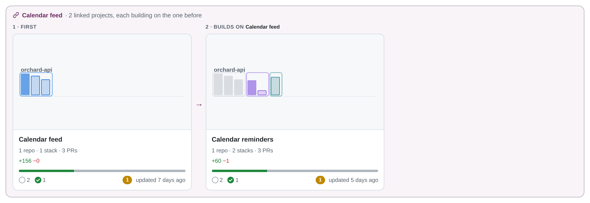
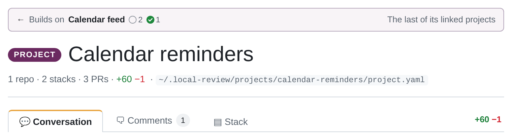
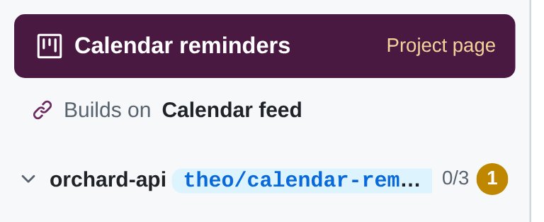
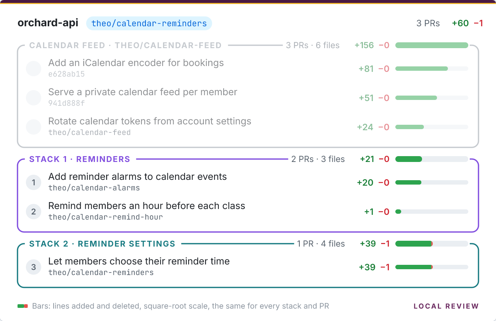

A big effort can be several **linked projects**, each building on the one before: a first project that goes up and
merges on its own, then a second one whose commits sit on top of it. Each is an ordinary
[project](/concepts/projects-and-repos/), with its own intro, stacks and review. The successor names the project it
builds on with `after:`:

```yaml title="~/.local-review/projects/calendar-reminders/project.yaml"
title: Calendar reminders
after: calendar-feed            # the project this one builds on: its slug (directory name)
repos:
  - path: ~/code/orchard-api    # the same clone calendar-feed reviews
    branch: theo/calendar-reminders
    base: origin/main
```

The link is one pointer, on the successor, like a branch's parent in Graphite or git-town. A chain of them is a chain
of projects; a project can have several successors.



## The ranges

In a repo both projects have (the same `path`, or else the same repo `name`), the successor's range **starts where
the predecessor's ends**: its `branch:` (or `to:`), exclusive. That holds **while that ref is an ancestor of the
successor's branch**, the normal state while both are in review: the successor's branch sits on top of the
predecessor's.

Once it isn't, the range starts at `merge-base(base, branch)` as for any repo. That's the state after the
predecessor has merged and the successor has been rebased onto the base: the predecessor's branch is no longer below
it. So `base:` stays in the successor's `project.yaml` the whole time; nothing needs editing when the predecessor
merges.

- **`from:` wins.** A repo with `from:` starts there, link or not.
- **Only shared repos.** A repo only the successor has is unaffected; the link is then just the order of the projects.
- **Live.** Moving the predecessor's branch, or editing its range, moves the successor's start, with no restart.
- **One branch per project.** Put the successor's commits on their own branch on top of the predecessor's, rather than
  ending the predecessor with `to:` on one branch: a `to:` sha moves with every rebase. Keep them aligned with
  `git rebase --update-refs`.

## When the link doesn't hold

Local Review never drops or hides commits from a range; it warns, on the successor's repo, and says what to do:

- **The range includes the predecessor's commits.** The predecessor was squash-merged (so its commits never reach the
  base) and the successor hasn't been rebased onto the base yet, and the predecessor's branch is gone or moved. The
  range then runs from the merge-base with the base and takes in the predecessor's PRs too. They're recognised by sha
  (the predecessor's [prs files](/reference/pr-files/) are named after its commits): rebase the successor onto the base.
- **The predecessor's branch is gone** and none of its PRs have landed.
- **A bad link:** `after:` names no project, the project itself, or makes a cycle (`a` after `b` after `a`). That's a
  warning on the project, and the projects aren't linked.

## Publishing

[`local-review plan`](/agents/plan-command/) on the successor bases its first PR in a shared repo on the
**predecessor's top PR's branch** (`base_from: predecessor`), so the two go up as one stack on GitHub, and warns while
that PR isn't published yet: publish the predecessor first. The predecessor's own plan is unchanged. After the
predecessor has merged and the successor is rebased, the first PR goes onto the repo base again.

## In the UI

- **The root page** shows linked projects together in one box spanning the row ("*Calendar feed* · 2 linked
  projects, each building on the one before"), their cards in order (`1 · FIRST`, `2 · BUILDS ON …`) with arrows. A chain is in the
  Archived section only once all of it has merged. The successor's thumbnail starts each shared repo's lane with the
  predecessor's stacks, in grey.
- **The project page** has a bar above the title: "← Builds on *Calendar feed*" with that project's readiness, and
  "Next: …" on the predecessor.

  

- **The sidebar** links both ways under the project link (**Builds on *…***, **Next *…* →**), and shows link
  warnings.

  

- **Breadcrumbs** on PR and stack pages start with the predecessor.
- **The project switcher** lists a successor right under its predecessor, indented.
- **PR and stack headers** show the predecessor's end as the base of the first PR.
- **The stack picture** can draw the predecessor's stacks too: **Show *Calendar feed*** on the project page's and a
  PR's Stack tab (`?context=1` in the [image URL](/using/stack-pictures/#as-an-image-url)). They come first in each
  shared repo, greyed out, without PR numbers, and are left out of every total. It's off by default, since the picture
  is what gets pasted into PRs.



## Splitting a project

To split an existing project into two linked ones: make one branch per project, create the new project with
`after:`, narrow the old one's range, and move the review data of the commits that changed project with
[`local-review move`](/reference/cli/#local-review-move): it copies their prs and reviews files into the new project
and renames the originals to `.bak`, deleting nothing. The [agent guide](/agents/agent-guide/#linked-projects) has the
steps. The [example projects](/reference/cli/#local-review-examples-remove) include a linked pair: *Calendar feed*
and *Calendar reminders*.
