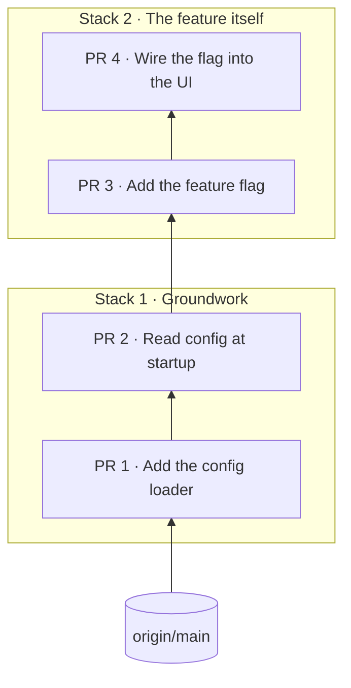

Each repo's commits are split into consecutive, colour-coded **PR stacks**: groups of PRs that go up to GitHub
together, one coherent chunk of work each. You pick each stack by the commit it `starts_at`, usually by its subject, so
stacks survive rebases.

```yaml
stacks:
  - title: Groundwork
    starts_at: "Add the config loader"
  - title: The feature itself
    starts_at: "Add the feature flag"
```



.")

## How stacks are formed

- A stack runs from its `starts_at` commit up to the next stack's start.
- The first stack may leave out `starts_at`: it then starts at the first commit. (Any other stack without one is
  empty, with a warning.)
- Commits before the first stack go into an implicit grey, dashed **Unstacked** group.
- No `stacks:` at all means one stack, named after the branch.
- PR numbers ("PR 3", `#3`) run 1..n across the whole repo, oldest first, not per stack, so they don't change when
  you regroup.

To regroup, edit `starts_at`. The UI picks it up live.

## How `starts_at` picks a commit

`starts_at` is tried as:

1. a **hex sha prefix**, 7 or more characters (quote it in YAML, or it may be read as a number);
2. a **commit subject**, compared after trimming, collapsing whitespace and stripping `fixup!`/`squash!`/`amend!`;
3. failing those, a **PR title** (a `title:` override in the PR's [prs file](/reference/pr-files/)), the same way.

Subjects survive rebases, so prefer them. A [landed PR](/concepts/landed-prs/)'s subject is its stored one, so a stack
whose bottom PRs have merged keeps its shape.

With duplicate subjects, the first match after the previous stack's start is used. A selector that matches nothing,
or only commits at or before the previous stack's start (out of order), makes that stack empty and shows a warning on
the repo in the sidebar.

## Colours

A stack's `color:` is one of `blue`, `green`, `purple`, `orange`, `pink`, `teal`, `red`, or a `"#hex"`. Without one,
stacks cycle through that list in order.

**Yellow is reserved for [follow-on stacks](/concepts/follow-on-stacks/).** A follow-on stack is always yellow,
whatever its `color:` says (the field can be left out), and `color: yellow` on a regular stack gives a warning and
falls back to the colour it would have had by default. (Hex colours aren't checked for yellowness.)

## Stack notes

A stack's `description:` is its **stack note**: Markdown that says how this stack relates to the others ("First of
three stacks: …"). It's the Conversation tab of the stack's [stack page](/using/ui-tour/#the-stack-page) and fills the
Stack context box of each of its PRs, it can be edited in place in both (with images), and it goes after the project intro in each of the stack's
[full PR bodies](/using/editing-pr-text/#copying-text-for-the-real-pr).

## Totals

Every aggregate counts **regular stacks' unmerged PRs only**, and mentions follow-on stacks and merged PRs beside it:

```text
2 repos · 4 stacks · 12 PRs · +3,300 −150 · +1 follow-on stack (2 PRs) · +9 merged
```

That applies to the stack picture's summary line and repo headings, the project page's totals, the sidebar's viewed count
and the project switcher's commit count. A stack whose PRs have all merged isn't counted among the stacks. A stack's
own heading and its PRs still show their real numbers.

When only follow-on work is in view (the picture of just a follow-on stack), its numbers are shown, labelled
`1 follow-on stack · 2 PRs`. Likewise when only merged work is (an archived project): `1 repo · 1 stack · 9 merged PRs`.
The arithmetic lives in `shared/totals.ts`, used by both the server and the UI, so they agree.

## Stacks and GitHub

A Local Review stack is a unit of review and of publishing: when it's ready, an agent opens it on GitHub as stacked
PRs, one stack at a time. Each repo becomes one GitHub stack, grown one Local Review stack at a time. See
[Publishing as GitHub stacked PRs](/agents/publishing-stacked-prs/), and
[Works with your stacking tool](/concepts/stacking-tools/) if you use something other than GitHub's own.
