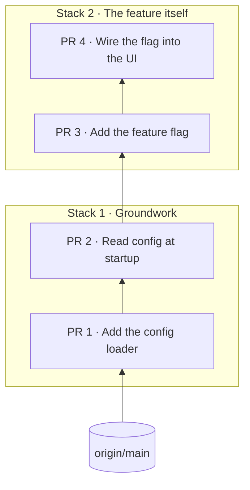

Each repo's commits are split into consecutive, colour-coded **PR stacks**: groups that go up to GitHub together, each picked out by the commit it `starts_at`. Stacks are selected by commit subject, so they survive rebases.

:::note[TODO: content]
This page is a stub. Its content will move here from the README's "Stacks" and "Colours" paragraphs.
:::
