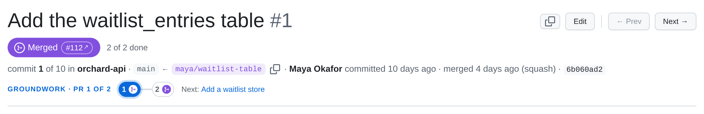

Every PR carries one **readiness** state. It starts as a **draft** while you review it, becomes **ready** when you
mark it so, **published** once an agent records the GitHub PR it created, and **merged** once it has landed. A badge on
every PR, and a count on every stack, show where things stand at a glance.

| State | Badge | Set by | Stored as |
| --- | --- | --- | --- |
| **Draft** | a small grey progress pie (a full pie at 100%: done, but not marked ready) | the default | no `status:` (or `status: draft`) |
| **Ready** | a white tick in a green circle | **the reviewer**, with the Draft \| Ready toggle | `status: ready` |
| **Published** | GitHub's PR icon in a blue circle | an agent, by recording the GitHub PR | a usable `github:` record |
| **Merged** | GitHub's merge icon in a purple circle | an agent, by freezing the merged PR | a usable `landed:` record |

, published (blue, with the GitHub link), ready (green tick) and draft (the pie fills as you review).")

## The rules

- **Draft and ready are stored** in the PR's [prs file](/reference/pr-files/) as `status:`. Absent means draft;
  marking a PR draft again removes the key.
- **Published is derived:** a PR is published as soon as it has a usable `github:` record, whatever `status:` says.
- **Merged is derived** from a usable `landed:` record, and wins over the rest. Purple is kept for merged alone.
- **Marking a PR ready is the reviewer's call.** Agents don't set `status: ready` unless asked, and don't clear it
  either.

## Progress

While a PR is a draft, its pie shows review progress: **(resolved + viewed) / (threads + files)**, where threads are
conversations with at least one comment (outdated ones included), and files are the files changed, of which some are
marked Viewed. The badge's tooltip has the details, e.g. "Draft · 6 of 15 done: 6/6 conversations resolved, 0/9 files
viewed", and the PR header shows the same (`6 of 15 done`).

The API gives each commit `status` (`draft`, `ready`, `published` or `merged`) and
`progress: {threads, resolved, files, viewed}`.

## Stacks

Once any PR in a stack is ready, the stack's bottom border says how many are (`2/4 READY`; published and merged count as
ready), and `4/4 MERGED` in purple once they've all merged.

## Where you set it

In the PR header, where GitHub shows Open / Draft, there's a **Draft | Ready** toggle that writes `status:` to the prs
file. Once the PR is published it's replaced by a blue **Published** pill with the `#1234 ↗` link, and once it has
merged by a purple **Merged** pill, with "merged &lt;when&gt; (method)" in the line below. Toggling, an agent's edits
to the prs file, and new Viewed marks or resolved threads all update the sidebar, header and stepper live.

## Before publishing

`local-review plan` warns about stacks that still contain draft PRs, and an agent asks before publishing one; only
the reviewer can clear that warning, by marking the PRs ready (or by telling the agent to go ahead anyway). See
[Publishing as GitHub stacked PRs](/agents/publishing-stacked-prs/).
