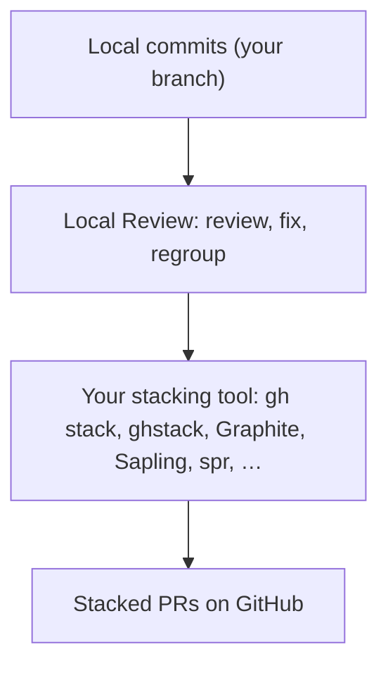

Every stacking tool starts from the same place: a series of commits on your machine. They differ in how they turn those
commits into pull requests. Local Review works on the commit side, **before** any of them runs: it reviews the commits
you're about to stack, as the PRs they'll become, and never touches GitHub. So it fits in front of whichever tool you
use, and needs nothing from it.

## GitHub native stacked PRs

GitHub's own **stacked pull requests** went generally available on
[6 October 2026](https://github.blog/changelog/2026-10-06-stacked-pull-requests-generally-available), on all
github.com plans, after a public preview from
[30 July 2026](https://github.blog/changelog/2026-07-30-stacked-pull-requests-are-now-in-public-preview/). Each PR's
base is the branch below it; GitHub shows a stack map in the PR header and merge box, merges bottom-up, and retargets
and rebases the rest as each one lands. Stacks live in one repo (they can't cross forks), and the
[`gh stack`](https://github.com/github/gh-stack) CLI extension manages them.

This is what Local Review publishes to. When a stack is ready, an agent follows the
[plan](/agents/plan-command/), opens one PR per commit with `gh pr create` (with the exact titles and bodies you
approved), and links them with `gh stack link`. See
[Publishing as GitHub stacked PRs](/agents/publishing-stacked-prs/). After they merge, the agent freezes them as
[landed PRs](/concepts/landed-prs/) so they stay in their stacks.

## Other tools

You don't have to publish with `gh stack`. Review in Local Review, then hand the reviewed commits to the tool you
already use. The tools below map commits to PRs in different ways; Local Review only needs the commits.

| Tool | How its stacks look on GitHub |
| --- | --- |
| [**GitHub native**](https://docs.github.com/en/pull-requests/get-started/about-stacked-prs) + [`gh stack`](https://github.com/github/gh-stack) | Each PR's base is the branch below it, with a stack map in the PR header. After a whole-stack merge, the upper PRs keep their old `baseRefName`. Same repo only. |
| **Graphite** (`gt`) | Chained bases; after a parent merges, GitHub retargets the PR to trunk. A stack list in a comment. Commercial and closed source; [acquired by Cursor](https://siliconangle.com/2025/12/19/cursor-acquires-ai-code-review-startup-graphite/) (announced December 2025). |
| [**ghstack**](https://github.com/ezyang/ghstack) | `gh/<user>/<n>/{base,head,orig}` branches: each PR's base is its own synthetic branch, so GitHub can't see the stack. The body has "Stack from ghstack (oldest at bottom)". PyTorch's standard; there a merge bot lands each PR and it shows *Closed*. |
| [**Sapling**](https://github.com/facebook/sapling) + [ReviewStack](https://reviewstack.dev) | `pr<N>` branches, all targeting `main`: each PR is cumulative and contains everything below it. |
| **spr** ([ejoffe/spr](https://github.com/ejoffe/spr), [getcord/spr](https://github.com/getcord/spr)) | One branch per commit (`spr/<trunk>/<hash>`), tracked by a commit trailer, with a stack list in the body. |
| [**git-spice**](https://github.com/abhinav/git-spice) (`gs`) | Chained bases and a navigation comment ("Change managed by git-spice"). Seen alongside native stacks. |
| [**git-town**](https://github.com/git-town/git-town) | Chained bases, with an optional breadcrumb list in the PR body. |
| [**git-branchless**](https://github.com/arxanas/git-branchless) | Mostly local stack editing; `git submit --forge github` is opt-in. |
| [**Aviator**](https://github.com/aviator-co/av) (`av`) | Chained bases with metadata comments; its merge queue can squash a parent into its child. |
| [**stack-pr**](https://github.com/modular/stack-pr) | `<user>/stack/<n>` branches and a "Stacked PRs:" list. |
| [**Jujutsu**](https://github.com/jj-vcs/jj) (`jj`) | `push-<change-id>` branches. jj's own project puts several commits in one PR and reviews them per commit, close to Local Review's one-commit-one-review model. |
| **Gerrit** | One change per commit with a `Change-Id:` trailer; no GitHub footprint. Local Review [re-attaches reviews by Change-Id](/concepts/following-rebases/#which-file-belongs-to-a-commit) too. |

Whichever you use, two habits make Local Review work well with it: **keep commit subjects stable and unique** (they
carry your review across rebases, and pick your stacks), and **rebase with `--update-refs`**, so per-commit branches
move with their commits.

## Real stacks to look at

A few public stacks that merged in 2026, each a good picture of what a reviewed stack becomes:

- **One feature across three repos: Astral's PGO release builds.** The same change, profile-guided optimisation for
  release binaries, went up as a GitHub native stack in each of [ruff](https://github.com/astral-sh/ruff)
  ([#27570](https://github.com/astral-sh/ruff/pull/27570) → [#27572](https://github.com/astral-sh/ruff/pull/27572)
  → [#27573](https://github.com/astral-sh/ruff/pull/27573) → [#27574](https://github.com/astral-sh/ruff/pull/27574)),
  [uv](https://github.com/astral-sh/uv) ([#21001](https://github.com/astral-sh/uv/pull/21001) →
  [#21002](https://github.com/astral-sh/uv/pull/21002) → [#21003](https://github.com/astral-sh/uv/pull/21003) →
  [#21004](https://github.com/astral-sh/uv/pull/21004)) and [ty](https://github.com/astral-sh/ty)
  ([#4213](https://github.com/astral-sh/ty/pull/4213) → [#4216](https://github.com/astral-sh/ty/pull/4216) →
  [#4217](https://github.com/astral-sh/ty/pull/4217) → [#4218](https://github.com/astral-sh/ty/pull/4218) →
  [#4236](https://github.com/astral-sh/ty/pull/4236)): a large base layer (the pipeline), then thin per-platform
  layers. That's the multi-repo shape a Local Review project is for: one project, three repos, a stack in each.
- **A small native stack: React DevTools.** [react/react](https://github.com/react/react)
  [#37152](https://github.com/react/react/pull/37152) → [#37151](https://github.com/react/react/pull/37151) →
  [#37155](https://github.com/react/react/pull/37155): clean up, reorder, then fix. Note the stack order isn't the PR
  number order; a Local Review PR's number is its position, too.
- **ghstack: PyTorch.** [pytorch/pytorch](https://github.com/pytorch/pytorch)
  [#193730](https://github.com/pytorch/pytorch/pull/193730) …
  [#193734](https://github.com/pytorch/pytorch/pull/193734), "Removing dead code from MPS (1/5 … 5/5)": landed by a
  merge bot, so the PRs show *Closed*, not merged.
- **Graphite: LLVM.** [llvm/llvm-project](https://github.com/llvm/llvm-project)
  [#202750](https://github.com/llvm/llvm-project/pull/202750) →
  [#203197](https://github.com/llvm/llvm-project/pull/203197) →
  [#203240](https://github.com/llvm/llvm-project/pull/203240) →
  [#203241](https://github.com/llvm/llvm-project/pull/203241): add tests (NFC), refactor, add a test, then the fix.
- **Two tools at once: Pulumi.** [pulumi/pulumi](https://github.com/pulumi/pulumi)
  [#24950](https://github.com/pulumi/pulumi/pull/24950) … [#24960](https://github.com/pulumi/pulumi/pull/24960), a
  native stack whose PRs also carry git-spice's navigation comment.

An agent can import a stack like these into Local Review as [landed PRs](/concepts/landed-prs/#importing-a-stack-that-already-merged),
for reference: the agent guide's
[Importing a historical stack](/agents/agent-guide/#importing-a-historical-already-merged-stack-for-reference-or-demos)
covers how each tool's merged stacks differ.
