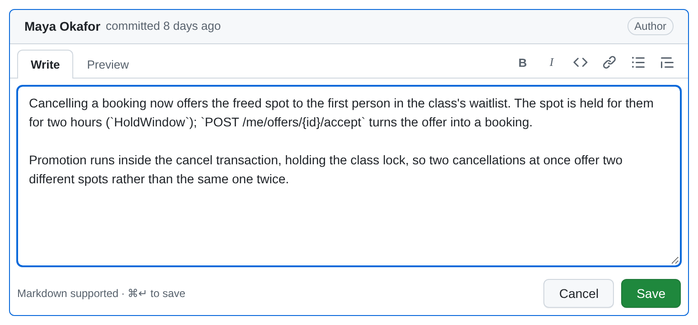
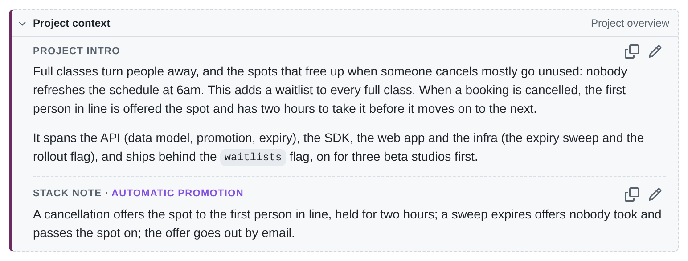

A PR's title and description start as its commit's subject and body. You can rewrite either in place: the edit is
saved to the PR's [prs file](/reference/pr-files/), **never to the commit**, so the reviewed repo is untouched. The copy
buttons then give you exactly the text the real GitHub PR should have, project context included.



## Editing

- **Title:** **Edit** beside the title turns it into an input. Enter saves, Esc cancels.
- **Description:** the pencil in the description's header (or **…** → Edit) opens a **Write / Preview** editor with a
  small toolbar (bold, italic, code, link, list, quote; ⌘B / ⌘I / ⌘K), prefilled with the current description.
  ⌘/Ctrl+Enter saves, Esc cancels (asking first if you changed something).
- **Back to the commit message:** saving text identical to the commit message clears the override instead. An
  overridden field shows **edited ▾** ("Edited locally; the commit message is unchanged"), whose menu shows the
  commit's version and has **Revert to commit message**.
- **If the file changes while you edit** (an agent rewrote the description): an untouched editor just follows it; one
  with your changes keeps them and offers **Load it** / **Keep mine**.
- **Drafts** survive switching tabs and commits, but not a reload (the browser warns before you leave).

An agent can do the same by writing `title:` / `body:` into the prs file, or with `PUT …/pr`; the UI shows it live.

## Images

PR descriptions, stack notes and the project intro can show images: a diagram, a screenshot, a before and after.
In any of their editors, **paste** an image (a screenshot from the clipboard), **drop** an image file onto it, or use
the **image button** in the toolbar. Each one is uploaded into the project's `assets/` folder, and its markdown goes
in at the cursor:

```markdown

```

- While it uploads, an `` placeholder holds its place and **Save** waits.
- PNG, JPEG, GIF, WebP and SVG, up to 5 MB. Anything else is refused with a message under the editor
  (`Couldn't add notes.png: the file isn't a PNG image …`), and its placeholder is removed.
- The same image added twice is stored once: files are named by their content.
- An agent adds one with `local-review asset add <project> <file>`, which prints the same markdown
  ([CLI](/reference/cli/#local-review-asset-add-project-file)).
- Images on the web (``) work as in any markdown. Comments show `assets/` images too, but have no upload.

Where the files live, and why they're never deleted: [Images](/reference/data-directory/#images).

### Seeing an image up close

Click an image (the cursor is a magnifier over the ones you can) to open it in a viewer over the page, scaled to
fit the window, with its title, or else its alt text, as the caption. That works wherever markdown is shown:
descriptions, stack notes, the project intro, comments, and an editor's **Preview**.

- **Click the image** (or the magnifier button) to see it at 100%, its full size, centred on the point you clicked.
  Scroll or drag to move around it; click again to fit it back to the window. An image that already fits at 100%
  has nothing to zoom to.
- **← / →**, or the arrows at the sides, step through the other images in the same description, note or comment,
  wrapping round at the ends; the top corner shows which one you're on (`2 / 4`).
- **Esc**, the **×** button or a click outside the image closes it, and focus goes back to the image. Images can be
  focused with Tab and opened with Enter, too.
- **Images in links keep the link.** A badge or a screenshot that links somewhere else opens its link, as on GitHub.
  An image linked to itself (`[](assets/….png)`) opens the viewer; ⌘/Ctrl- or shift-click it
  to open the link instead.

While the viewer is open, the other [keyboard shortcuts](/using/keyboard-shortcuts/) are off, so `j` / `k` don't
move you to another PR behind it.

:::caution[GitHub can't see them]
The images are on your machine, so the **Full body** you copy still says `assets/<name>`, which GitHub can't show.
Drag the image into the PR on GitHub when you create it, or record where it's published with
`local-review asset url`, so [`local-review plan`](/agents/plan-command/) puts that URL in the body instead. The plan
warns about every image that has no URL. More: [Publishing: images](/agents/publishing-stacked-prs/#images).
:::

## Project context

On the Conversation tab, above the description, a compact **Project context** box shows the project intro and this
PR's stack note, each with **Copy** and **Edit**. Edit opens the same editor as the description (Write/Preview, the
toolbar, ⌘↵ saves, Esc cancels, and a "changed elsewhere" notice). Collapse the box with its chevron; that's remembered
(in localStorage, for every PR and project). **Project overview** goes to the homepage.



- The **project intro** is `description:` at the top of `project.yaml`: context for the whole effort.
- The **stack note** is `description:` on the stack: how this stack relates to the others.

Saving writes just that one field into `project.yaml`, keeping its comments and formatting. The UI never writes text
you didn't type: nothing is generated. Details: [How the UI edits project.yaml](/reference/project-yaml/#how-the-ui-edits-it).

## Copying text for the real PR

| Button | Copies |
| --- | --- |
| The copy icon beside the title | The plain title (no `#n`). |
| The copy icon in the description header | The description's raw Markdown. |
| **…** → Copy title + description | The title, a blank line, then the body. |
| **Full body** (beside the copy icon), or **…** → Copy full PR body | What the real PR's body should be (below). |

The **full body** is the project intro, a blank line and the stack note (if there is one), then a blank line, `---`, a
blank line, and the PR description. Missing parts are left out:

```markdown
Why this effort exists, …          ← the project intro

First of three stacks: …           ← the stack note

---

What this PR changes, and why.     ← the PR description
```

The separator is `CONTEXT_SEPARATOR` in `shared/prText.ts`, and [`local-review plan`](/agents/plan-command/) composes
exactly the same text, so what an agent publishes matches what you copied.
