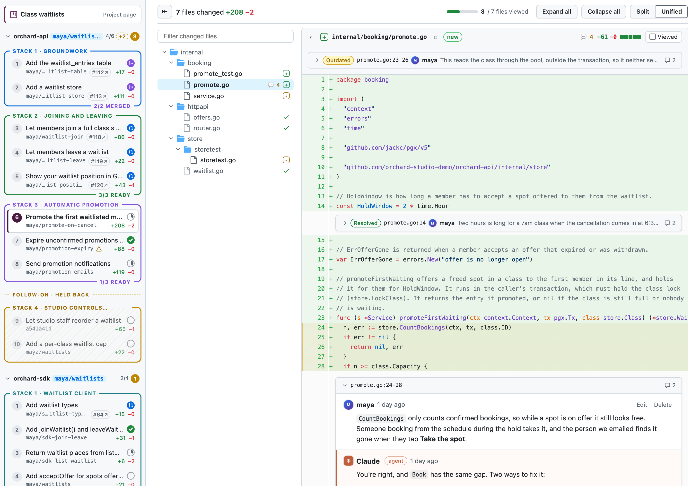
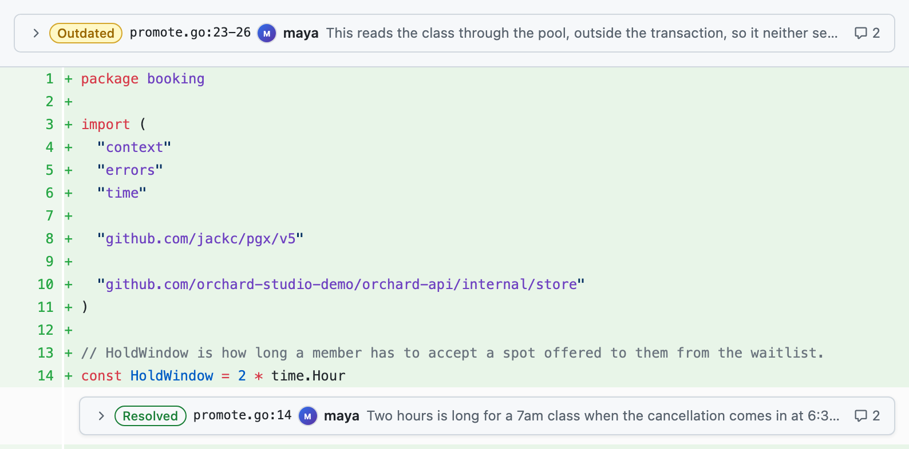
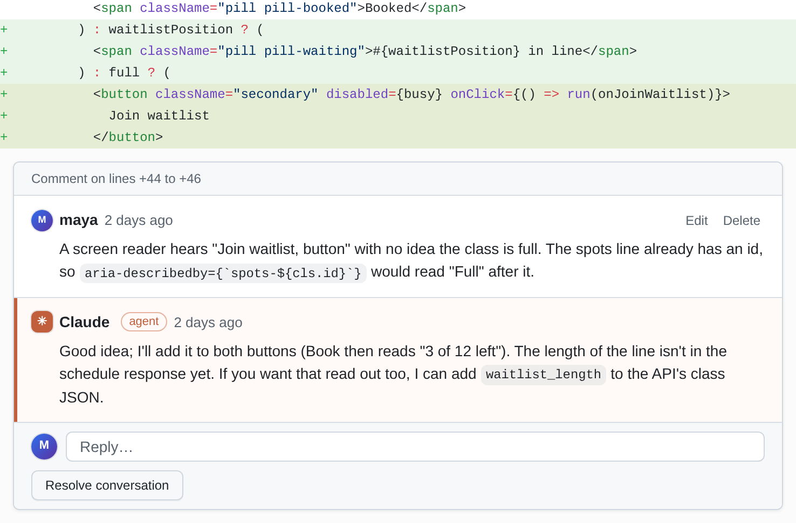
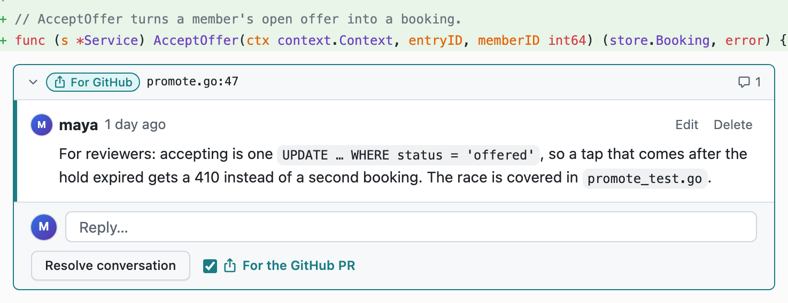

Reviewing works the way it does on GitHub: read the diff, comment on a line or a range of lines, reply, resolve, and
tick files **Viewed** as you go. The difference is where it goes: every comment is saved to a plain YAML
[comment file](/agents/comment-files/) that your agent reads and replies to, and its replies appear in the browser as
it works.

## Files changed

- **Split or Unified** view (remembered). The unified view has old and new line-number columns.
- **Expand all / Collapse all**, and a **file tree**: directories collapse, single-child chains are compacted, the
  file you're reading is highlighted, and there's a filter.
- **Viewed:** a checkbox per file, saved to the comment file. A viewed file collapses, and the toolbar shows your
  progress.
- **Context:** the bars between hunks expand 20 lines up or down, or **Expand all**.
- **Big and odd files:** files with more than 800 changed lines show "Load diff" instead of the diff. Binary files, pure
  renames and empty files get their own placeholders. Off-screen diffs render as you scroll.
- `n` / `p` go to the next / previous file ([Keyboard shortcuts](/using/keyboard-shortcuts/)).

Diffs are rendered with [`@pierre/diffs`](https://diffs.com) (Shiki's `github-light` / `github-dark` themes), from the
full old and new file contents, so you can expand any unchanged context. Each commit is diffed against its first
parent.

## Inline comments

- **One line:** hover a diff line and click the blue **+** in the gutter.
- **A range:** drag over the line numbers (or the **+**), or click one line number and shift-click another. A
  multi-line selection opens the comment form.
- **Across old and new lines:** a range that mixes deleted and added lines in the unified view keeps both ends exactly
  ("Comment on lines -12 to +15", stored with `start_side`). If one end is an unchanged line, it's saved on one side.

Threads render under their (last) line, with **Reply** and **Resolve** / **Unresolve**, and their header names the
file and line (`ClassCard.tsx:44-46` for a range; a range across old and new lines also says "Comment on lines -12 to
+15"). A range's lines are tinted, more strongly while you hover the thread. A thread whose line isn't in a shown hunk
is listed at the top of its file card.

Every thread here has a chevron in its header, to fold it to one row: **Resolved** or **Outdated**, `file:line`, who
started it and the start of what they said, and how many comments it has. Click the row to open it again. **Resolved
and outdated threads start folded**, open ones open. Resolving a thread folds it, and unresolving it (or an agent
reopening it in the file) opens it. What you fold lasts until you leave the page; nothing is saved.

When the commit is amended or rebased, threads follow their code; one whose code is gone is marked **Outdated** and
shows the original lines. See [Following rebases](/concepts/following-rebases/).

## General comments

The Conversation tab holds the PR's general threads (those without a file and line), with the same Reply and Resolve.
Outdated threads show there too, with an "Outdated" label and their original code. Resolved threads fold, as on
GitHub: each run of them becomes one **N resolved conversations** row that opens them again.

## Comments for the GitHub PR

Some comments are for the PR's readers on GitHub, not for your agent: a note on why the code is the way it is, a
question for a colleague. Tick **For the GitHub PR** when you write one (in the Conversation tab's comment box, or
under a new inline comment), or on any existing thread, beside **Resolve conversation**: on the PR's Conversation
tab, in Files changed, or in the Comments tab. Untick it to make the thread local again.

- **What it changes:** the thread gets a teal **For GitHub** label and a teal edge, so it stands apart from resolved
  (green) and outdated (yellow) ones. It isn't an open thread any more: your agent doesn't answer it, and it's left
  out of the open-thread counters and of the PR's review progress.
- **Where it goes:** when your agent publishes the stack, it posts these threads as one GitHub review per PR (a
  "Comment" review, never an approval): inline ones at their lines, general and outdated ones in the review's body.
  It then records where each went, and the label becomes **On GitHub ↗**, a link to the comment. A reply you add to
  a marked thread goes with it.
- **At a glance:** the Comments tab's **For GitHub** button lists them, with a count, and says how many aren't
  posted yet. `local-review plan` lists them for each PR, with file and line.
- **Resolving it doesn't stop it going.** To keep a thread off GitHub, untick the box.

Local Review still never talks to GitHub: the mark is a `publish: true` in the review file
([schema](/reference/comment-files/#threads-for-the-github-pr)), and your agent does the posting
([how](/agents/publishing-stacked-prs/#comments-for-the-github-pr)). Nothing is ever read back from GitHub.

## Every thread in one place

To see the threads of a whole stack or project at once, open the **Comments** tab on its
[stack page](/using/ui-tour/#the-stack-page) or [project page](/using/ui-tour/#the-project-page). It lists every
thread on every PR there, published or not: open ones first, then the most recently updated. The tab's counter is the
number of open threads. Each thread says which PR it's on, and an inline one says its `file:line`, which opens Files
changed at that thread. Resolved and outdated threads start folded, as in Files changed. You can reply, resolve, edit
and delete there too, and an agent's replies show up live. Its **For GitHub** button lists the
[comments for the GitHub PR](#comments-for-the-github-pr). See [The Comments tab](/using/ui-tour/#the-comments-tab).

## Who you are

Your comments are stored as `author: <id>`, and **only yours can be edited or deleted** in the UI. An agent's
(`author: claude`) never are. Your name comes from `LOCAL_REVIEW_USER`, else `git config user.name`, else `$USER`, and
your id is its first word, lowercased ("Ada Lovelace" → `ada`). If your comment files were written under another id,
set `LOCAL_REVIEW_USER` to it to keep them yours. See
[Environment variables](/reference/environment/#local_review_user-the-reviewer).

Deleting your comment removes it from the file; the previous version is in the
[snapshots](/reference/data-directory/#snapshots).

## Getting your agent to reply

Your agent works through the open threads, fixes the commits, replies in each thread and resolves the ones that were
clear instructions it carried out exactly; the rest it leaves for you. The quickest way to start it off is the
[hand-off prompt](/agents/hand-off-prompt/).
