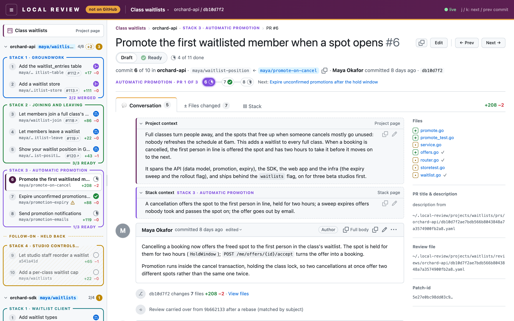
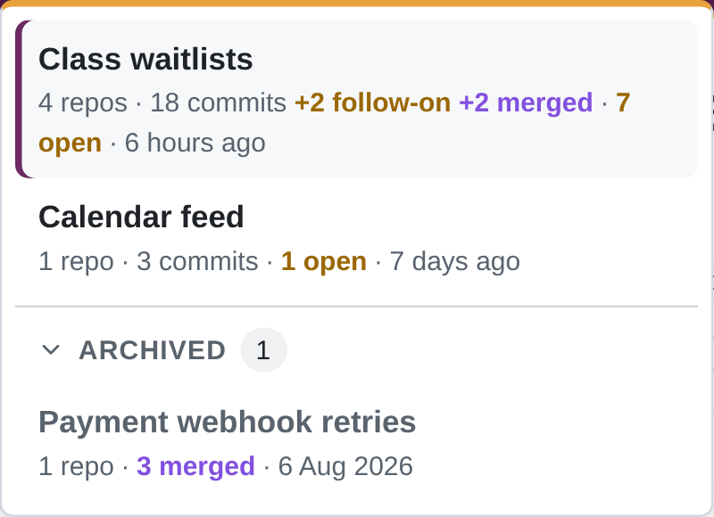
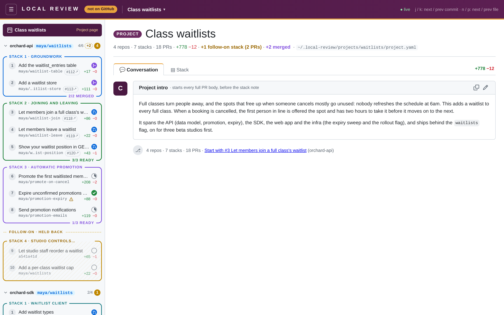

Local Review's layout follows GitHub's pull-request page closely, so it should feel familiar: a sidebar of PRs, and for
each PR a header and Conversation, Files changed and Stack tabs. Under a header that is deliberately **not** GitHub's.

## The header: deliberately not GitHub

The top bar is **deep plum (`#4a1942`) with an amber underline**. It carries a letter-spaced **LOCAL REVIEW** wordmark
and an amber **"not on GitHub"** pill, and selected tabs get an amber top edge. You can't mistake it for github.com,
which matters when the rest of the page looks just like a PR you could merge.

The header also shows the project title, with a **project switcher** when there's more than one project. Archived
projects (everything [landed](/concepts/landed-prs/)) are in a collapsed **Archived** section at the bottom of the
switcher. Click the project title to go to the project's homepage.

## The sidebar

- **One collapsible section per repo**, headed `repo · branch`, with how many commits are fully viewed and how many
  threads are open. A repo with nothing live shows a purple `merged` pill instead of its branch.
- **Each [PR stack](/concepts/pr-stacks/)** is a box with a coloured border and its title on the top line
  (`STACK 1 · GROUNDWORK`). Unstacked commits are grey and dashed. [Follow-on stacks](/concepts/follow-on-stacks/) come
  last, yellow, under a `FOLLOW-ON · HELD BACK` divider.
- **Each PR row** has its number ("PR 2"; numbered 1..n across the repo, oldest first), its title, its
  [branch](/concepts/branches/) (middle-truncated; the short sha if none; a warning icon if the recorded branch moved,
  struck through if it's missing), a `#1234 ↗` badge once the GitHub PR exists, +/− counts on the right, and one
  [readiness badge](/concepts/readiness/), whose tooltip has the details.
- **A stack's bottom border** counts its ready PRs once there are any (`2/4 READY`), and says `4/4 MERGED` in purple
  once they've all merged.
- **Problems:** a missing repo or branch shows an error card, a stack problem a warning.

## The PR header

- The PR title with its position in the repo (`#3`), and **Edit** beside it (see
  [Editing PR titles & descriptions](/using/editing-pr-text/)).
- Where GitHub shows Open / Draft, a **Draft | Ready** toggle; or a blue **Published** pill with the `#1234 ↗` link once
  a GitHub PR is recorded; or a purple **Merged** pill once it has landed, with "merged &lt;when&gt; (method)" in the
  line below.
- The review progress (`6 of 15 done`, with details in its tooltip).
- "commit 3 of 10 in &lt;repo&gt;", and a **stepper** of the PRs in this stack, in its colour
  (`GROUNDWORK · PR 3 of 4`), each with its readiness badge.

Toggling readiness, an agent's edits to the prs file, and new Viewed marks or resolved threads update the sidebar,
header and stepper live.

## The tabs

- **Conversation:** the [Project context](/using/editing-pr-text/#project-context) box, the PR description, and the
  general and inline threads. At the bottom, the path of the review file it's reading.
- **Files changed:** the diff, with a file tree, Split/Unified, and **Viewed** checkboxes. See
  [Reviewing & comments](/using/reviewing-and-comments/).
- **Stack:** a picture of the project's stacks with this PR highlighted. See [Stack pictures](/using/stack-pictures/).

## The project homepage

`/<project>` (or click the project title in the header) shows:

- the project intro, editable in place;
- the [stack picture](/using/stack-pictures/) for the whole project, nothing highlighted, with Copy / Download;
- a list of repos → stacks → PRs linking to each, with the project's and each repo's totals (follow-on stacks left out
  and mentioned, as in the picture), the same readiness badges as the sidebar, and for each stack its weight (PRs,
  distinct files, +/−) and its note (Edit, or "Add a stack note").

## URLs

| URL | |
| --- | --- |
| `/` | The most recently modified project's first commit. |
| `/<project>` | The project's homepage. |
| `/<project>/<repo>` | The repo's first commit. |
| `/<project>/<repo>/<sha>` | A PR (a short or full sha). |
| `…?tab=files` / `…?tab=stack` | The Files changed or Stack tab. Add `&file=<path>` to jump to a file. |

Old `/<repo>/<sha>` URLs (from before projects) redirect into the project that has that repo.

## Live updates and dark mode

Everything updates live: branches are polled every 2 seconds and the data files are watched, so a new commit, a new
branch, an agent's reply or an edit to `project.yaml` shows up without a reload. Dark mode follows your OS setting.
