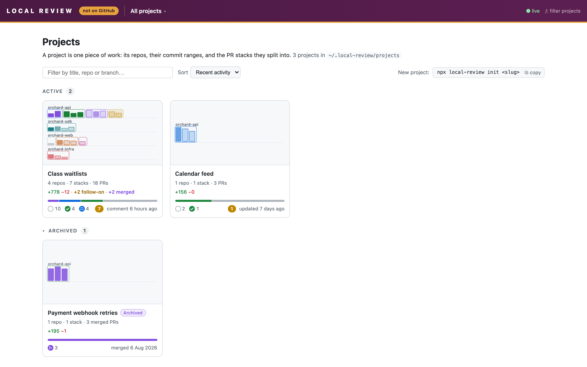
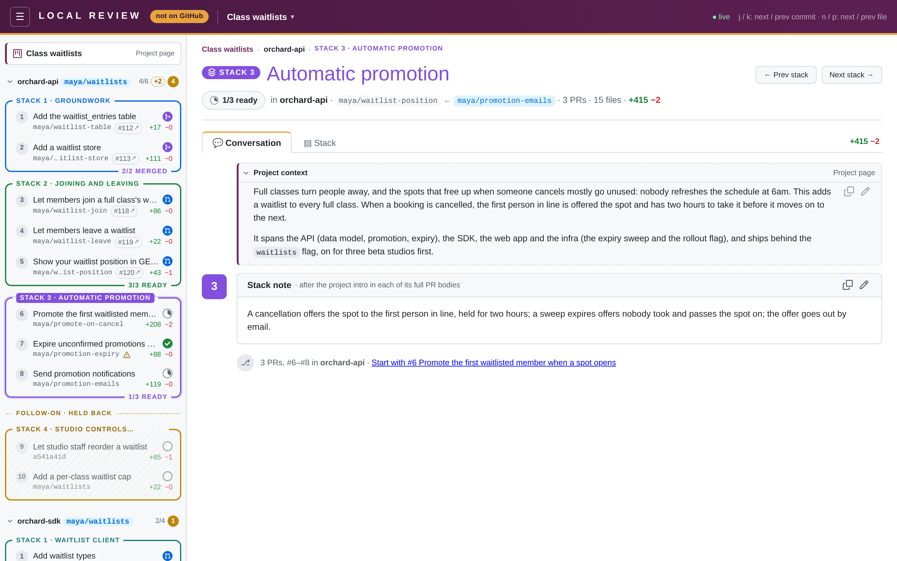

Local Review's layout follows GitHub's pull-request page closely, so it should feel familiar: a sidebar of PRs, and for
each PR a header and Conversation, Files changed and Stack tabs. Under a header that is deliberately **not** GitHub's.

## The header: deliberately not GitHub

The top bar is **deep plum (`#4a1942`) with an amber underline**. It carries a letter-spaced **LOCAL REVIEW** wordmark
and an amber **"not on GitHub"** pill, and selected tabs get an amber top edge. You can't mistake it for github.com,
which matters when the rest of the page looks just like a PR you could merge.

The **LOCAL REVIEW** wordmark goes to the [root page](#the-root-page), every project at once. Next to it is the
project you're in, with a **project switcher**: its first item, **All projects**, is the root page too, then the
projects themselves, most recently active first. Archived projects (everything [landed](/concepts/landed-prs/)) are in
a collapsed **Archived** section at the bottom of the switcher. Click the project title to go to the
[project page](#the-project-page).

## The root page

`/` lists every project as a card, most recently active first. A **project** is one piece of work: its repos, their
commit ranges, and the [PR stacks](/concepts/pr-stacks/) they split into ([Projects & repos](/concepts/projects-and-repos/)).

- **The thumbnail** is the project's shape, the same size however big it is: a lane per repo (the first three, then
  `+N more repos`), a box per stack in its colour, left to right, and a bar per PR. Every bar is the same width, so a
  1-PR repo is visibly short beside an 11-PR one; its height is the PR's lines changed (on a log scale, so one huge PR
  doesn't flatten the rest). Its fill is the PR's [readiness](/concepts/readiness/): faint and outlined while a draft,
  stronger once ready, solid once published, purple once merged. [Follow-on stacks](/concepts/follow-on-stacks/) are
  hatched yellow.
- **Below it:** the title (with **Example** or **Archived** on those), `repos · stacks · PRs`, the +/− lines with
  follow-on and merged PRs beside them ([Totals](/concepts/pr-stacks/#totals)), a bar of the PRs by readiness (merged,
  published, ready, draft), the same as readiness badges with counts, the open threads, and the **last activity**: the
  newest comment, commit, merge or edit to any of the project's files (a Viewed mark, a title, an agent's YAML).
- **Sections:** Active; **Examples**, once you have projects of your own besides the [example projects](/reference/cli/#local-review-examples-remove)
  (with **Remove example projects**); and **Archived**, collapsed.
- **Filter** (press `/`) matches the title, slug, repo names and branch names; **Sort** by recent activity, title, size
  or open threads (remembered). The `npx local-review init <slug>` line starts a new project.
- With no projects yet, `/` is the first-run page instead, with the example projects one click away.

## The sidebar

- **The project page link** at the top: the project's title, plum while you're on the [project page](#the-project-page).
- **One collapsible section per repo**, headed `repo · branch`, with how many commits are fully viewed and how many
  threads are open. A repo with nothing live shows a purple `merged` pill instead of its branch.
- **Each [PR stack](/concepts/pr-stacks/)** is a box with a coloured border and its title on the top line
  (`STACK 1 · GROUNDWORK`). Click the title to open the [stack page](#the-stack-page); the stack you're on has its
  title filled in its colour. Unstacked commits are grey and dashed. [Follow-on stacks](/concepts/follow-on-stacks/) come
  last, yellow, under a `FOLLOW-ON · HELD BACK` divider.
- **Each PR row** has its number ("PR 2"; numbered 1..n across the repo, oldest first), its title, its
  [branch](/concepts/branches/) (middle-truncated; the short sha if none; a warning icon if the recorded branch moved,
  struck through if it's missing), a `#1234 ↗` badge once the GitHub PR exists, +/− counts on the right, and one
  [readiness badge](/concepts/readiness/), whose tooltip has the details.
- **A stack's bottom border** counts its ready PRs once there are any (`2/4 READY`), and says `4/4 MERGED` in purple
  once they've all merged.
- **Problems:** a missing repo or branch shows an error card, a stack problem a warning.

## The PR header

- **Breadcrumbs** above it: `Project › repo · STACK 2 · TITLE › PR #3`. The project and the stack are links to their
  pages.
- The PR title with its position in the repo (`#3`), and **Edit** beside it (see
  [Editing PR titles & descriptions](/using/editing-pr-text/)).
- Where GitHub shows Open / Draft, a **Draft | Ready** toggle; or a blue **Published** pill with the `#1234 ↗` link once
  a GitHub PR is recorded; or a purple **Merged** pill once it has landed, with "merged &lt;when&gt; (method)" in the
  line below.
- The review progress (`6 of 15 done`, with details in its tooltip).
- "commit 3 of 10 in &lt;repo&gt;", and a **stepper** of the PRs in this stack, in its colour
  (`GROUNDWORK · PR 3 of 4`), each with its readiness badge. The stack's name there opens its stack page.

Toggling readiness, an agent's edits to the prs file, and new Viewed marks or resolved threads update the sidebar,
header and stepper live.

## The tabs

- **Conversation:** the [Project context and Stack context](/using/editing-pr-text/#project-and-stack-context) boxes,
  the PR description, and the general and inline threads. At the bottom, the path of the review file it's reading.
- **Files changed:** the diff, with a file tree, Split/Unified, and **Viewed** checkboxes. See
  [Reviewing & comments](/using/reviewing-and-comments/).
- **Stack:** a picture of the project's stacks with this PR highlighted. See [Stack pictures](/using/stack-pictures/).

## The project page

`/<project>` (the link at the top of the sidebar, the first breadcrumb, or the project title in the header) is laid out
like a PR page: a plum `PROJECT` label and the title, a line with the project's totals (follow-on stacks and merged PRs
left out and mentioned, as in the picture) and where its `project.yaml` is, then two tabs:

- **Conversation:** the project intro, as the first comment box, with Copy and Edit (the same editor, image
  attachment and "changed elsewhere" notice as a PR description). Below it, a link to the first PR to review.
- **Stack:** the [stack picture](/using/stack-pictures/) for the whole project, nothing highlighted, with Show title
  and Copy / Download.

It doesn't list the repos, stacks and PRs: the sidebar does that, and each stack's title there opens its stack page.

## The stack page

`/<project>/<repo>/stacks/<n>-<title>` (click a stack's title in the sidebar, its name in a PR's stepper, or its
breadcrumb) is one stack, laid out like a PR page:

- **The header:** a `STACK n` label in the stack's colour and its title in the same colour; ← / → to the previous and
  next stack in the project; then the readiness tally (`2/4 ready`, green once they all are, or a purple **Merged**
  pill once they've all landed), a follow-on badge if it's one, the repo, what the stack sits on and its top branch
  (`base ← top`), its PRs, distinct files and +/−, and how many have merged.
- **Conversation:** the [Project context](/using/editing-pr-text/#project-and-stack-context) box, then the stack note
  as the first comment box, with Copy and Edit (the same editor, image attachment and "changed elsewhere" notice as a
  PR description). An empty note offers **Add a stack note**. Below it, a link to the stack's first PR.
- **Stack:** the [stack picture](/using/stack-pictures/) of just this stack, with Show title and Copy / Download.

Its PRs aren't listed again: the sidebar shows them, in the stack's box. Unstacked commits and a repo without
`stacks:` get a stack page too (`…/stacks/unstacked`, `…/stacks/branch`), but no note: only stacks declared in
`project.yaml` have one.

## URLs

| URL | |
| --- | --- |
| `/` | The [root page](#the-root-page): every project. |
| `/<project>` | The project page. |
| `/<project>/<repo>` | The repo's first commit. |
| `/<project>/<repo>/<sha>` | A PR (a short or full sha). |
| `/<project>/<repo>/stacks/<ref>` | A stack page. `<ref>` is the stack's number in `stacks:` and its title as a slug (`2-joining-and-leaving`), or `unstacked` / `branch` for the implicit groups. |
| `…?tab=files` / `…?tab=stack` | The Files changed or Stack tab (project and stack pages have Conversation and Stack). Add `&file=<path>` to jump to a file. |

Old `/<repo>/<sha>` URLs (from before projects) redirect into the project that has that repo.

A stack page's URL keeps working when `stacks:` is edited. The number finds the stack, and the title notices a change:
if the list was reordered, the link follows the title to its new number; if the stack was renamed, it stays on the
number. Either way the address is updated to the stack's ref now. A bare number (`…/stacks/2`) works too.

## Moving between PRs

A PR you've already opened, the ones either side of it, and a sidebar row you rest the pointer on are loaded in the
background, so they open at once. Anything else keeps the PR you were on in view, with a thin amber bar along the top
of the window, until the next one is ready: never a blank page. A new PR opens at the top, unless the link points at a
file in it. The same goes from a project or stack page: it stays up until the PR is ready, and the PR its **Start
with** link points at is loaded as soon as you arrive. Project and stack pages themselves open at once. What's kept in
the browser is refreshed when the files or branches change, so it's never out of date.

## Live updates and dark mode

Everything updates live: branches are polled every 2 seconds and the data files are watched, so a new commit, a new
branch, an agent's reply or an edit to `project.yaml` shows up without a reload. Dark mode follows your OS setting.
